# AEGIS - experiment results

This file is written by `python/experiments/report.py` from `results/*/results.json`; to rerun everything, use `.venv/bin/python python/experiments/run_all.py`. All exploitability numbers are exact best responses in the game stated: the full game for Kuhn, Leduc and Coin Toss, and the constructed spot (ranges + bet sizes) for Hold'em. None of them says anything about full No-Limit Hold'em.

Environment: Apple M3, 8 cores, macOS-27.0.1-arm64-arm-64bit-Mach-O, Python 3.13.6, run 2026-11-02 12:17:30.

## 1. Exact equilibria (Kuhn, Leduc)

*NashConv vs iterations. This is the basic check that CFR is right.*

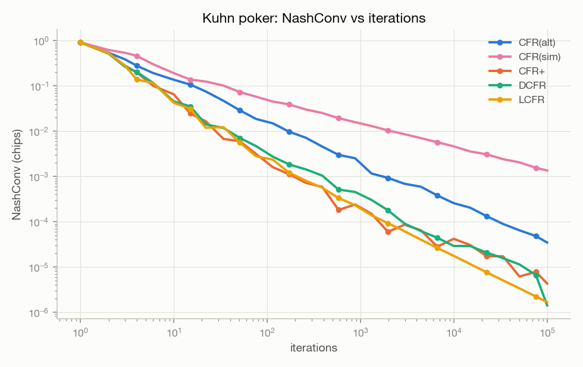

| algorithm (100k it) | NashConv | value P0 (-1/18 = -0.055556) | α = P0 J-bet | Q-call - (α+⅓) | P1 Q-call (⅓) |
|---|---|---|---|---|---|
| CFR(alt) | 3.462e-05 | -0.055556 | 0.2028 | 7.3624e-05 | 0.3334 |
| CFR(sim) | 0.001 | -0.055555 | 0.2053 | 0.0025 | 0.3334 |
| CFR+ | 4.284e-06 | -0.055556 | 0.2330 | 8.9730e-06 | 0.3333 |
| DCFR | 1.411e-06 | -0.055556 | 0.1873 | 2.3330e-06 | 0.3333 |
| LCFR | 1.673e-06 | -0.055556 | 0.2185 | 5.6469e-06 | 0.3333 |

Sequence-form LP (solved separately, as a cross-check): Kuhn value **-0.055556** (closed form -1/18 = -0.055556); Leduc value **-0.0856064**, LP strategy NashConv 3.025e-15; CFR+ (5000 it) value -0.0856060, NashConv 3.161e-05.

Compared with OpenSpiel (tests/python/test_openspiel_oracle.py): same tree sizes and information sets, NashConv of random policies agrees to 1e-9, and the CFR, CFR+ and DCFR average policies match OpenSpiel's at every iteration (max |Δσ̄| < 1e-9) on Kuhn and Leduc.

## 2. Leduc: exploitability vs time

*Same game and same wall-clock budget. Sampling methods use 5 seeds (mean ± 95% CI).*

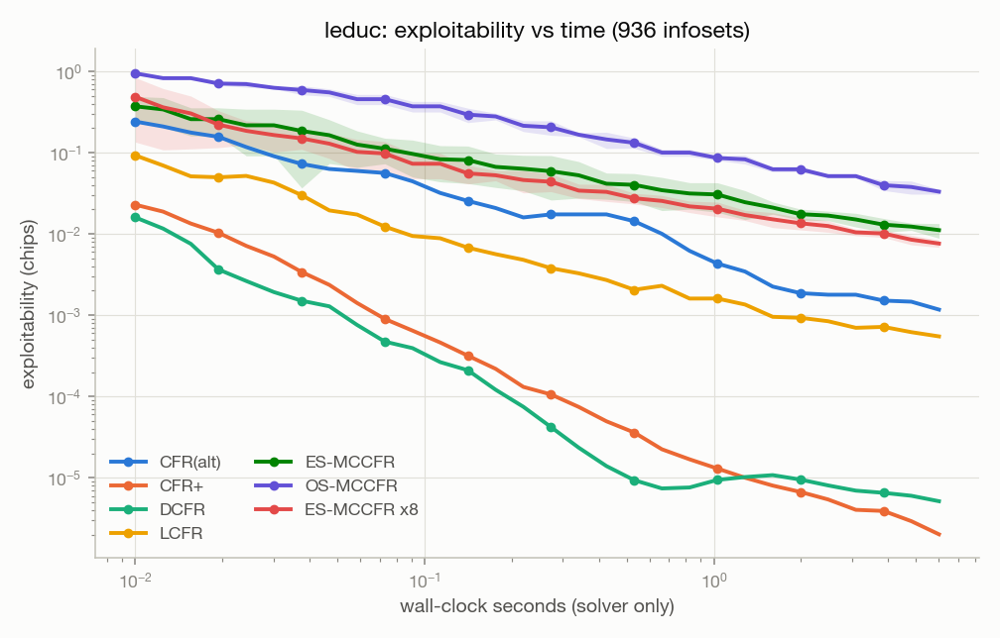
 
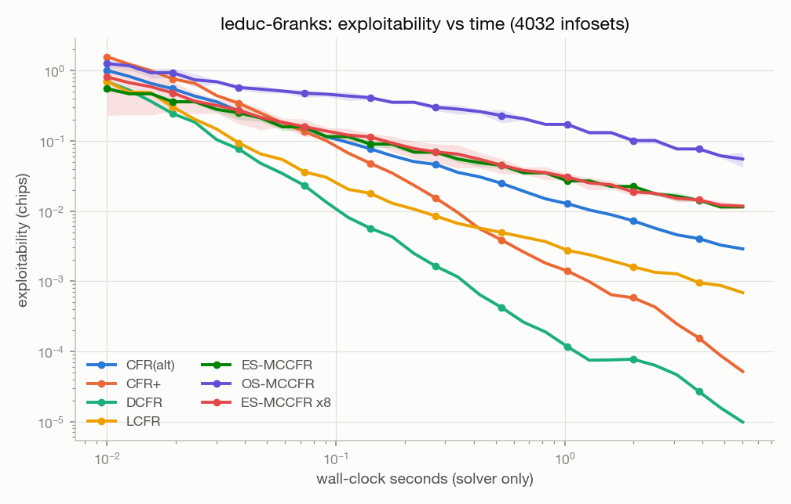

**leduc** (936 information sets):

| method | exploitability at budget | iterations |
|---|---|---|
| CFR(alt) | 0.001 | 22256 |
| CFR+ | 2.023e-06 | 30507 |
| DCFR | 5.189e-06 | 38459 |
| LCFR | 5.471e-04 | 30471 |
| ES-MCCFR | 1.113e-02 ± 2.3e-03 | - |
| OS-MCCFR | 3.309e-02 ± 2.2e-03 | - |
| ES-MCCFR x8 | 7.613e-03 ± 7.8e-04 | - |

**leduc-6ranks** (4032 information sets):

| method | exploitability at budget | iterations |
|---|---|---|
| CFR(alt) | 0.003 | 4783 |
| CFR+ | 5.151e-05 | 3688 |
| DCFR | 9.957e-06 | 4538 |
| LCFR | 6.853e-04 | 4853 |
| ES-MCCFR | 1.144e-02 ± 5.4e-04 | - |
| OS-MCCFR | 5.496e-02 ± 1.3e-02 | - |
| ES-MCCFR x8 | 1.173e-02 ± 7.8e-04 | - |

## 3. CFR+ vs DCFR: which one wins where?

*Same games and iteration budgets. A ratio below 1 means DCFR ended up less exploitable than CFR+.*

| game | iterations | CFR | CFR+ | DCFR | LCFR | DCFR/CFR+ | best |
|---|---|---|---|---|---|---|---|
| kuhn | 20000 | 7.213e-05 | 6.680e-06 | 1.185e-05 | 4.297e-06 | 1.77 | LCFR |
| leduc | 3000 | 0.005 | 3.408e-05 | 1.299e-05 | 0.002 | 0.38 | DCFR |
| leduc-6ranks | 1500 | 0.008 | 2.462e-04 | 7.928e-05 | 0.002 | 0.32 | DCFR |
| river-deep-allin | 2000 | 0.325 | 0.031 | 0.006 | 0.018 | 0.18 | DCFR |
| river-demo | 2000 | 0.056 | 0.003 | 8.885e-04 | 0.004 | 0.27 | DCFR |
| river-polarised-1size | 2000 | 0.022 | 1.864e-04 | 4.267e-04 | 5.962e-04 | 2.29 | CFR+ |

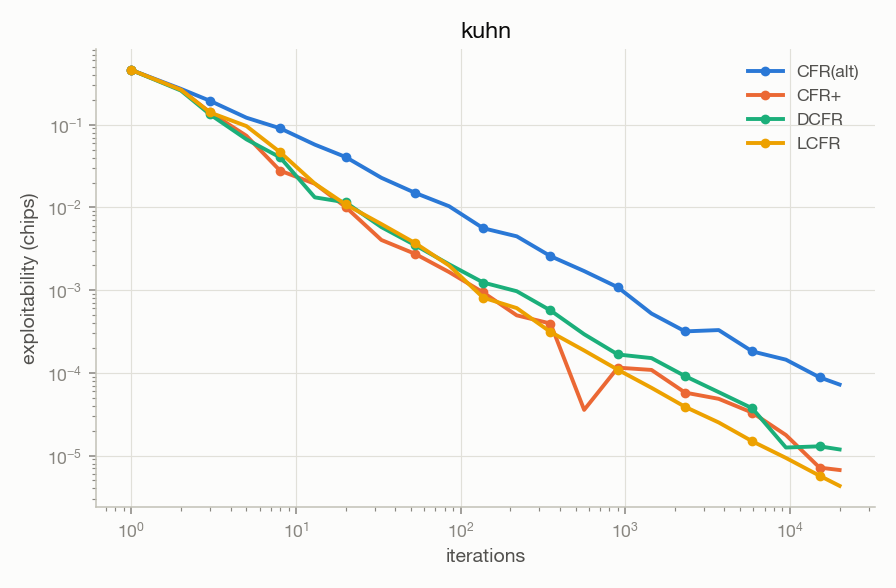 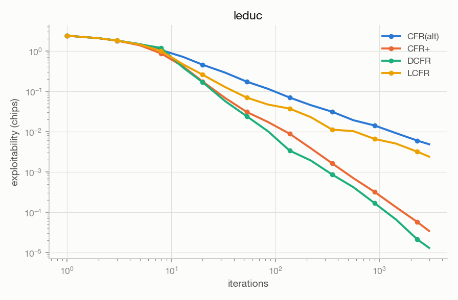 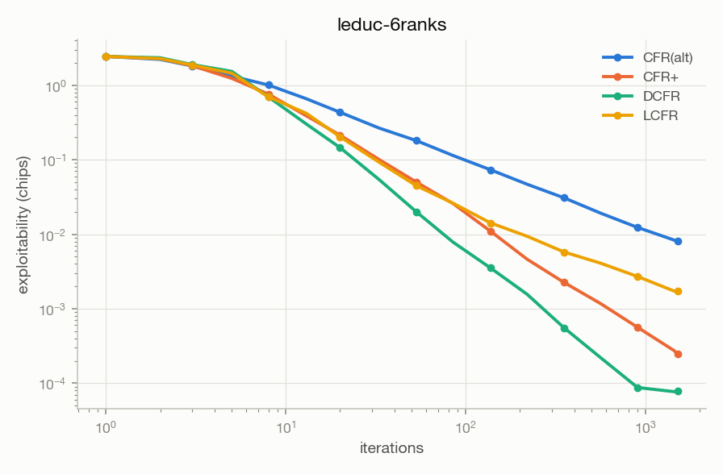 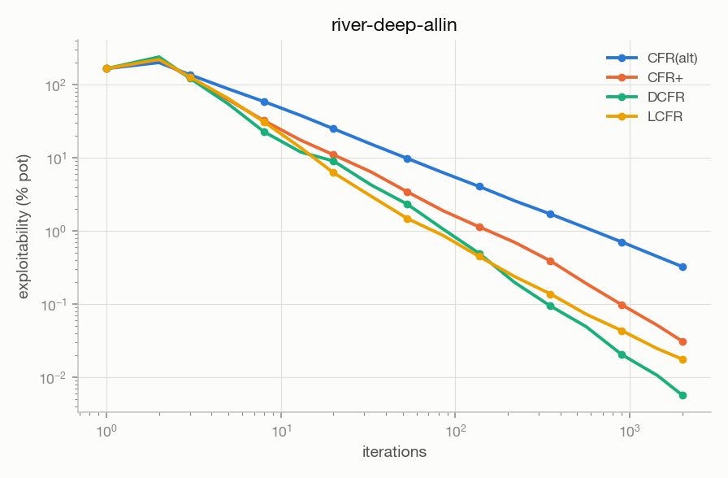 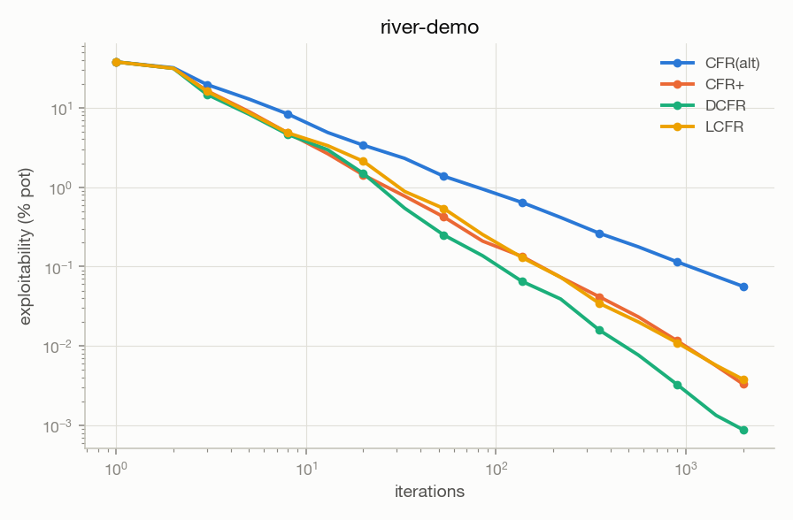 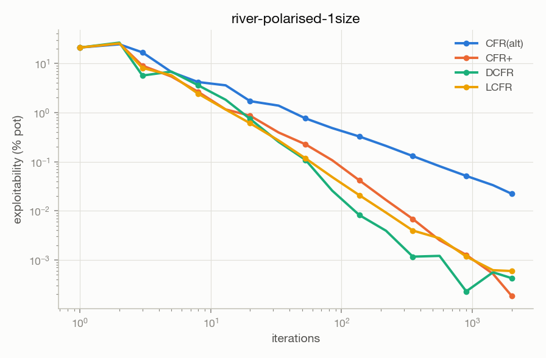

DCFR discounts the regret from early iterations, which helps when those early iterations are badly wrong (deep stacks with all-in actions, the bigger Leduc). CFR+ wins on Kuhn and on the polarised river spot with a single bet size. So neither is better everywhere, which is why I ran both on the same games.

## 4. Exact river solving

*Weighted ranges and custom bet sizes. Exploitability is the exact best-response gain in the river game as constructed.*

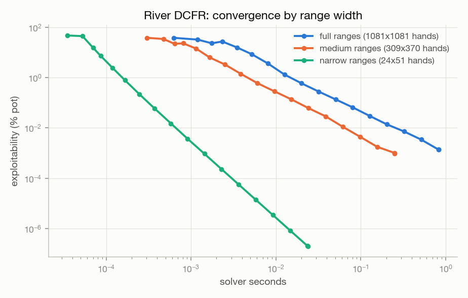

| ranges | hands | iterations | seconds | exploitability (% pot) |
|---|---|---|---|---|
| full ranges | 1081x1081 | 1500 | 0.833 | 0.00138 |
| medium ranges | 309x370 | 1500 | 0.252 | 9.49409e-04 |
| narrow ranges | 24x51 | 1500 | 0.024 | 1.97915e-07 |

Demo spot (A♠K♥8♣4♦2♠, pot 100, stacks 150): exploitability **8.87294e-04% of pot** after 2000 DCFR iterations. Hero A♦J♦ facing a 75 BB bet: Fold 0.00% (EV 0.00 BB), Call 100.00% (EV 47.54 BB), AllIn 150 0.00% (EV 32.97 BB). 30 hands in player 1's range play a mixed strategy at that node, e.g. JdJc {'Fold': 0.145, 'Call': 0.855, 'AllIn 150': 0.0}; JhJc {'Fold': 0.173, 'Call': 0.827, 'AllIn 150': 0.0}; JhJd {'Fold': 0.144, 'Call': 0.856, 'AllIn 150': 0.0}; JsJc {'Fold': 0.145, 'Call': 0.855, 'AllIn 150': 0.0}.

Checked against the generic tabular solver (the same game written out as an explicit tree with 432 information sets / 34915 histories): max strategy difference 2.288e-07 after 200 DCFR iterations; NashConv 0.026742 vs 0.026742; vector solver 22x faster.

With full ranges the explicit tree would need 1,070,190 hand pairs x 33 public nodes ~ 3.53e+07 histories, which is too big for the tabular solver. The vector solver handles it with 1.7 MB in 0.11 s (200 iterations, 0.038% pot), and exact best responses still work.

## 5. Bet-size abstraction: exploitability vs tree size

*Each abstract solution is translated into a reference game with 9 bet sizes and measured there exactly.*

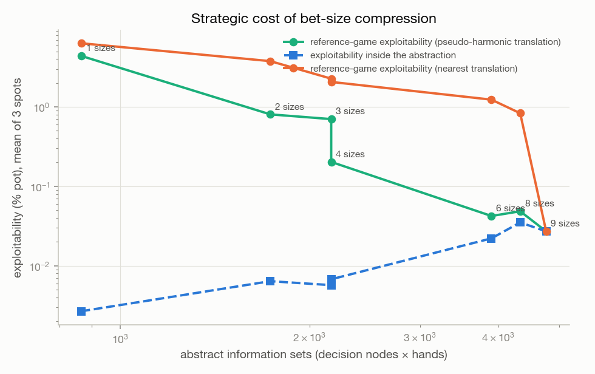

| bet sizes | abstract infosets | expl. inside abstraction (% pot) | reference expl., pseudo-harmonic | reference expl., nearest |
|---|---|---|---|---|
| 1 | 867 | 0.0027 | 4.3791 | 6.3247 |
| 2 | 1733 | 0.0064 | 0.8049 | 3.7677 |
| 3 | 2167 | 0.0057 | 0.7020 | 2.2675 |
| 4 | 2167 | 0.0068 | 0.2028 | 2.0625 |
| 6 | 3900 | 0.0221 | 0.0423 | 1.2337 |
| 8 | 4333 | 0.0351 | 0.0485 | 0.8321 |
| 9 | 4767 | 0.0271 | 0.0271 | 0.0271 |

Exploitability measured *inside* the abstraction tells you very little. In the reference game, coarse abstractions are much worse than they look, and the choice of translation mapping matters about as much as adding more sizes.

## A. Priority-guided sampling (Experiment A)

*Same node budget for every method. λ was tuned the same way for each one on separate seeds, then evaluated on 8 new seeds and on a bigger game it wasn't tuned on. Mean ± 95% CI.*

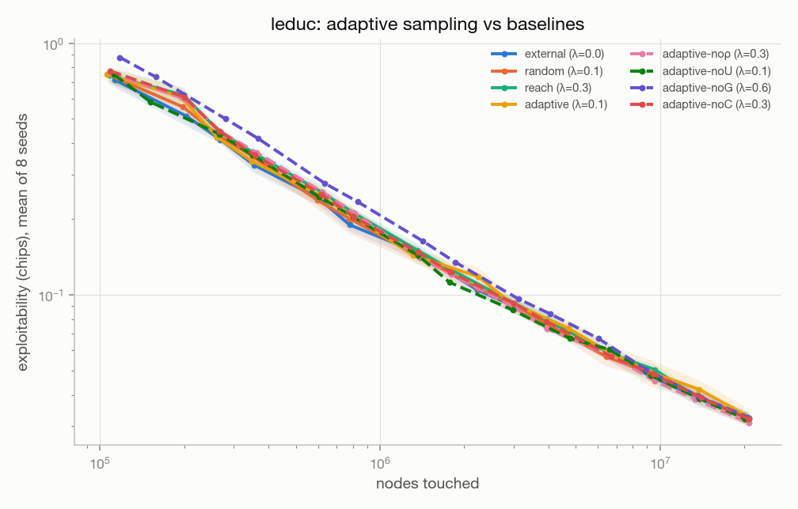
 
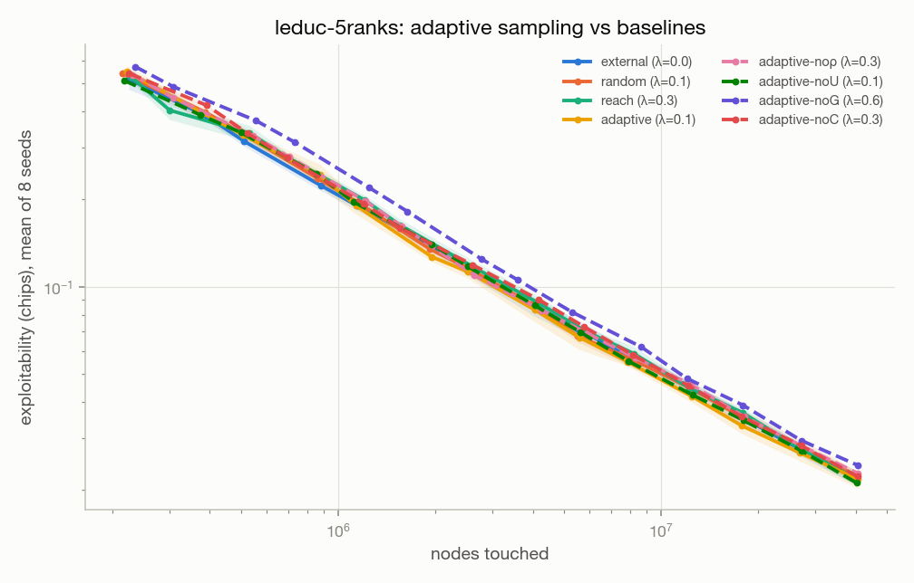

**leduc**:

| method | λ | final exploitability | paired diff vs external |
|---|---|---|---|
| external | 0.0 | 0.0323 ± 0.0020 | - |
| random | 0.1 | 0.0319 ± 0.0019 | -3.3407e-04 ± 0.0025 (5/8 seeds better) |
| reach | 0.3 | 0.0324 ± 0.0014 | 1.4908e-04 ± 0.0024 (5/8 seeds better) |
| adaptive | 0.1 | 0.0334 ± 0.0026 | 0.0011 ± 0.0040 (3/8 seeds better) |
| adaptive-noρ | 0.3 | 0.0308 ± 0.0018 | -0.0014 ± 0.0029 (6/8 seeds better) |
| adaptive-noU | 0.1 | 0.0321 ± 0.0019 | -1.4495e-04 ± 0.0030 (3/8 seeds better) |
| adaptive-noG | 0.6 | 0.0326 ± 9.8699e-04 | 3.8043e-04 ± 0.0025 (3/8 seeds better) |
| adaptive-noC | 0.3 | 0.0321 ± 0.0012 | -1.3244e-04 ± 0.0024 (3/8 seeds better) |

**leduc-5ranks**:

| method | λ | final exploitability | paired diff vs external |
|---|---|---|---|
| external | 0.0 | 0.0219 ± 0.0012 | - |
| random | 0.1 | 0.0222 ± 0.0010 | 2.7444e-04 ± 0.0015 (3/8 seeds better) |
| reach | 0.3 | 0.0217 ± 0.0011 | -1.5946e-04 ± 0.0017 (3/8 seeds better) |
| adaptive | 0.1 | 0.0217 ± 0.0015 | -2.0684e-04 ± 0.0011 (4/8 seeds better) |
| adaptive-noρ | 0.3 | 0.0227 ± 0.0013 | 8.2864e-04 ± 0.0013 (2/8 seeds better) |
| adaptive-noU | 0.1 | 0.0211 ± 0.0013 | -7.9708e-04 ± 0.0023 (4/8 seeds better) |
| adaptive-noG | 0.6 | 0.0242 ± 0.0019 | 0.0023 ± 0.0029 (2/8 seeds better) |
| adaptive-noC | 0.3 | 0.0222 ± 0.0015 | 2.8257e-04 ± 0.0025 (4/8 seeds better) |

Estimator efficiency with the strategy held fixed (Leduc):

| sampler | regret-estimate MSE | nodes / sample | MSE x cost | nodes / s |
|---|---|---|---|---|
| external | 238.5 | 27.3 | 6507 | 3.72e+07 |
| random | 316.5 | 30.8 | 9734 | 1.95e+07 |
| reach | 223.1 | 30.3 | 6768 | 1.67e+07 |
| adaptive | 187.3 | 28.0 | 5246 | 1.33e+07 |

**Result.** With the strategy held fixed, the adaptive sampler's regret-estimate MSE x cost is 0.81x that of external sampling. At the same node budget, none of the priority rules beat plain external sampling by more than the 95% confidence interval, on Leduc or on the bigger held-out game, and the extra bookkeeping costs throughput. So on these games, steering samples by sensitivity/uncertainty did **not** buy lower exploitability per unit of compute. The samplers are all tested to be unbiased, so this is about efficiency, not correctness.

## 7. Safe vs naive re-solving (full-game exploitability)

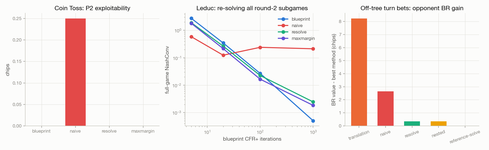

**Coin Toss** - exploitability of player 2's strategy:

| blueprint | blueprint | naive | resolve | maxmargin |
|---|---|---|---|---|
| converged blueprint | 1.7906e-05 | 0.2500 | 1.7627e-05 | 1.7627e-05 |
| unconverged blueprint | 0.0068 | 0.2500 | 0.0067 | 0.0067 |

**Leduc** - NashConv after re-solving all 30 round-2 subgames for both players:

| blueprint CFR+ iterations | blueprint | naive | resolve | maxmargin |
|---|---|---|---|---|
| 5 | 2.7425 | 0.5856 | 1.8932 | 1.7999 |
| 20 | 0.3473 | 0.1239 | 0.2656 | 0.2153 |
| 100 | 0.0268 | 0.2401 | 0.0225 | 0.0165 |
| 1000 | 5.0658e-04 | 0.2125 | 0.0025 | 0.0018 |

Naive re-solving helps when the blueprint is bad, but makes good blueprints a lot more exploitable. The gadget methods stay close to the blueprint (the small increases at 1000 iterations come from the 400-iteration re-solves not being fully converged).

**No-Limit turn -> river re-solving** (240 river subgames re-solved per player; full solve reference 0.011% pot) - exploitability (% pot):

| blueprint | blueprint | naive | resolve | maxmargin |
|---|---|---|---|---|
| unconverged (12 it) | 8.153 | 5.672 | 7.330 | 6.542 |
| coarse abstraction + translation | 5.012 | 13.265 | 4.352 | 4.049 |

**Nested re-solving after bet sizes the abstraction doesn't have** (opponent turn bets of Bet 30) - opponent's best-response value against our strategy (lower is better):

| method | opponent BR value (BB) |
|---|---|
| translation | 13.898 |
| naive | 8.316 |
| resolve | 6.017 |
| nested | 6.021 |
| reference-solve | 5.672 |

Safe nested re-solving (constrained by the opponent's best alternative inside the abstraction) closes almost all of the gap between action translation and solving the reference game directly.

## 8. Learned leaf values: network error vs solving quality

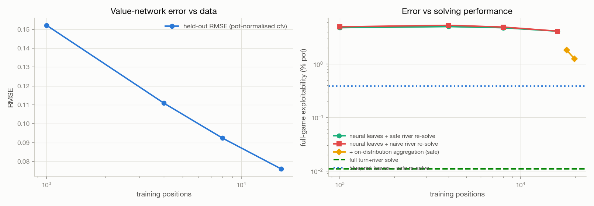

Training data: 20000 solver-generated river positions (523 s on 8 threads); target quality: mean exploitability 0.0109% pot (max 0.183%).

| training positions | test RMSE | target std | |zero-sum residual| | depth-limited solve (s) | full-game expl. (safe re-solve, % pot) | (naive re-solve) |
|---|---|---|---|---|---|---|
| 1000 | 0.1521 | 0.4268 | 0.0308 | 13.25 | 4.785 | 4.985 |
| 4000 | 0.1109 | 0.4268 | 0.0212 | 15.60 | 5.018 | 5.314 |
| 8000 | 0.0924 | 0.4268 | 0.0171 | 13.71 | 4.774 | 4.927 |
| 16000 | 0.0761 | 0.4268 | 0.0132 | 13.41 | 4.117 | 4.135 |

Adding on-distribution data (the leaf ranges depth-limited CFR actually asks about, solved exactly and added to the training set):

| round | new positions | train size | on-distribution RMSE before | full-game expl. safe (% pot) | naive (% pot) |
|---|---|---|---|---|---|
| 1 | 1920 | 17920 | 0.0788 | 1.819 | 1.763 |
| 2 | 1920 | 19840 | 0.0711 | 1.260 | 1.293 |

Full turn+river solve: 0.011% pot in 1.80 s. Blueprint leaves: safe 0.390%, naive 0.309% pot.

The safety guarantee for re-solving assumes exact leaf values, and the network's values aren't exact, so the table reports the full-game exploitability that actually came out.

On speed: this two-street tree is small enough to solve exactly in seconds, so the depth-limited solve with the network (mostly batched inference at the leaves) is slower than just solving it. A value network only pays off when the full tree is too big to build (earlier streets, deeper trees). I used the turn here because it's a place where the network's cost in exploitability can be measured exactly.

## 9. Performance

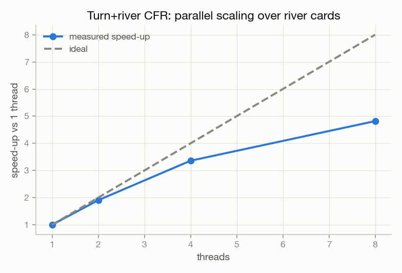
 
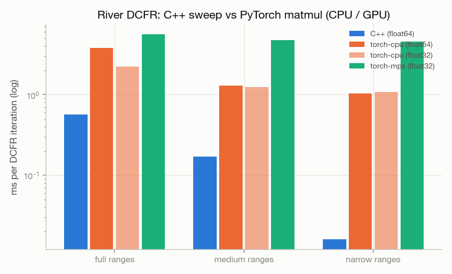
 
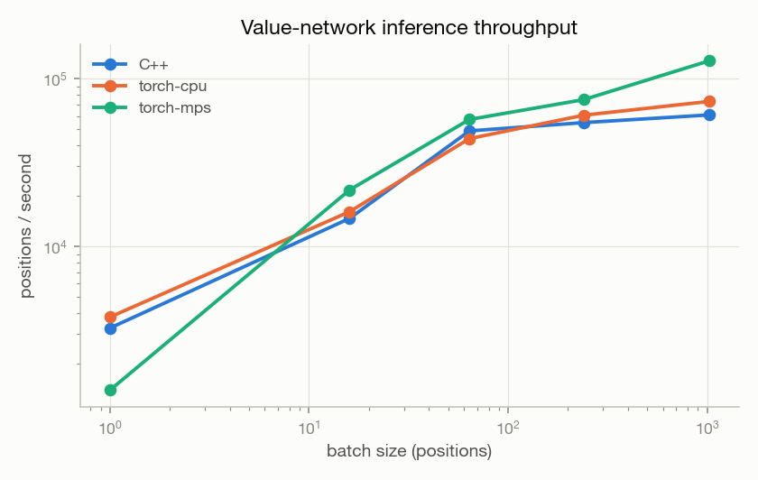

| benchmark | configuration | throughput | latency |
|---|---|---|---|
| evaluator_7card | random hands | 3.037e+07 evals_per_sec |  |
| tabular_cfr | leduc flat arrays | 1.177e+08 nodes_per_sec |  |
| tabular_cfr | leduc object-per-node | 4.356e+06 nodes_per_sec |  |
| tabular_scaling | leduc ranks=3 | 1.213e+08 nodes_per_sec |  |
| tabular_scaling | leduc ranks=6 | 1.313e+08 nodes_per_sec |  |
| tabular_scaling | leduc ranks=9 | 1.332e+08 nodes_per_sec |  |
| mccfr | external serial | 4.737e+07 nodes_per_sec |  |
| mccfr | external parallel threads=1 | 4.247e+07 nodes_per_sec |  |
| mccfr | external parallel threads=2 | 6.960e+07 nodes_per_sec |  |
| mccfr | external parallel threads=4 | 1.209e+08 nodes_per_sec |  |
| mccfr | external parallel threads=8 | 1.415e+08 nodes_per_sec |  |
| river_cfr | dcfr full 1081x1081 | 2.535e+08 hand_node_updates_per_sec | 0.563 ms/it |
| river_cfr | dcfr medium | 2.642e+08 hand_node_updates_per_sec | 0.170 ms/it |
| river_cfr | dcfr narrow | 3.074e+08 hand_node_updates_per_sec | 0.016 ms/it |
| turn_cfr_threads | full ranges threads=1 | 2.015e+08 hand_node_updates_per_sec | 68.465 ms/it |
| turn_cfr_threads | full ranges threads=2 | 3.839e+08 hand_node_updates_per_sec | 35.928 ms/it |
| turn_cfr_threads | full ranges threads=4 | 6.767e+08 hand_node_updates_per_sec | 20.384 ms/it |
| turn_cfr_threads | full ranges threads=8 | 9.707e+08 hand_node_updates_per_sec | 14.209 ms/it |
| value_net_cpu | mlp 2x512 batch=1 | 3983.430 rows_per_sec |  |
| value_net_cpu | mlp 2x512 batch=16 | 15237.100 rows_per_sec |  |
| value_net_cpu | mlp 2x512 batch=64 | 50883.400 rows_per_sec |  |
| value_net_cpu | mlp 2x512 batch=256 | 62278.700 rows_per_sec |  |
| value_net_cpu | mlp 2x512 batch=1024 | 70879.800 rows_per_sec |  |

| SIMD ablation | vectorised ms | scalar ms | speed-up |
|---|---|---|---|
| river_cfr dcfr full 1081x1081 | 0.563 | 0.610 | 1.08x |
| river_cfr dcfr medium | 0.170 | 0.187 | 1.10x |
| river_cfr dcfr narrow | 0.016 | 0.018 | 1.12x |
| turn_cfr_threads full ranges threads=1 | 68.465 | 70.702 | 1.03x |
| turn_cfr_threads full ranges threads=2 | 35.928 | 38.351 | 1.07x |
| turn_cfr_threads full ranges threads=4 | 20.384 | 21.095 | 1.03x |
| turn_cfr_threads full ranges threads=8 | 14.209 | 15.233 | 1.07x |

| ranges | backend | ms / iteration | expl. after 60 it (% pot) |
|---|---|---|---|
| full | C++ (float64) | 0.571 | 0.2473 |
| full | torch-cpu (float64) | 3.807 | 0.2473 |
| full | torch-cpu (float32) | 2.242 | 0.2473 |
| full | torch-mps (float32) | 5.607 | 0.2473 |
| medium | C++ (float64) | 0.170 | 0.2484 |
| medium | torch-cpu (float64) | 1.287 | 0.2484 |
| medium | torch-cpu (float32) | 1.236 | 0.2484 |
| medium | torch-mps (float32) | 4.726 | 0.2484 |
| narrow | C++ (float64) | 0.016 | 0.0030 |
| narrow | torch-cpu (float64) | 1.029 | 0.0030 |
| narrow | torch-cpu (float32) | 1.074 | 0.0030 |
| narrow | torch-mps (float32) | 4.585 | 0.0030 |

| ranges | hands | iterations to 0.1% pot | seconds | memory (MB) |
|---|---|---|---|---|
| full | 1081x1081 | 110 | 0.063 | 1.7 |
| medium | 309x370 | 110 | 0.019 | 0.6 |
| narrow | 24x51 | 20 | 3.553e-04 | 0.1 |

Hardware counters: not available - kperf requires root on macOS (run the benchmark with sudo); counters disabled. On Linux the same benchmark reads cycles, instructions, cache and branch misses through perf_event_open.

The GPU isn't automatically faster. With narrow ranges, kernel launches and transfers dominate; the O(n) C++ sweep beats an O(n²) dense matmul on the CPU, and MPS only catches up when the matrices are large.

## B. Adding bet sizes where they matter (Experiment B)

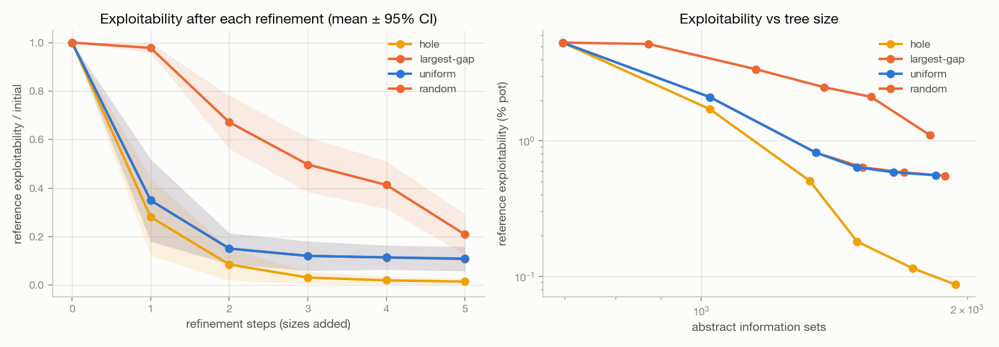

| method | reference exploitability / initial, per step | final (% pot) |
|---|---|---|
| hole | 1.000 -> 0.281 -> 0.085 -> 0.031 -> 0.020 -> 0.015 | 0.0866 |
| largest-gap | 1.000 -> 0.349 -> 0.151 -> 0.121 -> 0.114 -> 0.107 | 0.5520 |
| uniform | 1.000 -> 0.349 -> 0.151 -> 0.121 -> 0.115 -> 0.110 | 0.5567 |
| random | 1.000 -> 0.978 -> 0.672 -> 0.497 -> 0.413 -> 0.209 | 1.1025 |

Paired difference (hole - baseline) in final relative exploitability over 8 spots: vs largest-gap: -0.092 ± 0.042 (hole better on 8/8); vs uniform: -0.095 ± 0.045 (hole better on 8/8); vs random: -0.194 ± 0.082 (hole better on 8/8).

**Result.** Picking the size with the largest translation hole is significantly better than largest-gap, uniform, random at the same number of added sizes.

## C. Learned refinement choice (Experiment C)

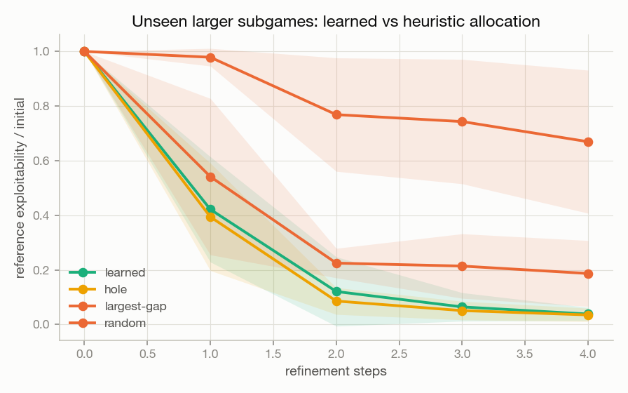

Trained on 1448 measured refinements from small games; the heuristic was tuned on the same data (chosen hole*reach^k/#sizes^m exponents [0.0, 0.5]). Ranking quality on unseen larger subgames (Spearman ρ between predicted and actual exploitability reduction per ms): learned 0.600, hole heuristic 0.704.

| controller | final reference exploitability / initial (6 unseen spots) |
|---|---|
| learned | 0.038 |
| hole | 0.035 |
| largest-gap | 0.187 |
| random | 0.604 |

Paired (learned - baseline): vs hole: 0.003 ± 0.013 (learned better on 3/6); vs largest-gap: -0.148 ± 0.140 (learned better on 6/6); vs random: -0.566 ± 0.236 (learned better on 6/6).

**Result.** On the larger held-out subgames the learned model is statistically indistinguishable from the translation-hole heuristic (tuned on the same data). Both are clearly better than largest-gap and random. So far the model doesn't add anything beyond the heuristic, which it gets as one of its inputs.

## 12. Where is compute worth spending? (budget allocation)

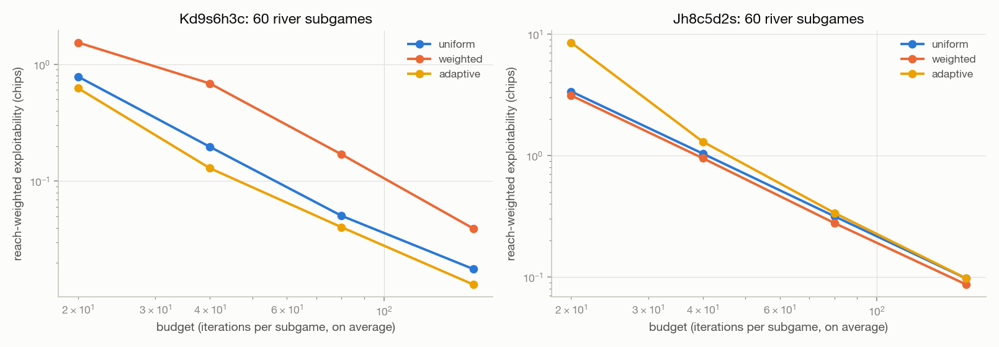

**Kd9s6h3c** - 60 river subgames, top-5 subgames hold 10% of the reach:

| budget (avg it/subgame) | uniform | weighted | adaptive |
|---|---|---|---|
| 20 | 0.7820 | 1.5300 | 0.6230 |
| 40 | 0.1967 | 0.6843 | 0.1292 |
| 80 | 0.0506 | 0.1695 | 0.0404 |
| 160 | 0.0178 | 0.0395 | 0.0131 |

Best policy per budget: 20: adaptive, 40: adaptive, 80: adaptive, 160: adaptive.

**Jh8c5d2s** - 60 river subgames, top-5 subgames hold 10% of the reach:

| budget (avg it/subgame) | uniform | weighted | adaptive |
|---|---|---|---|
| 20 | 3.3578 | 3.1115 | 8.4787 |
| 40 | 1.0328 | 0.9467 | 1.2945 |
| 80 | 0.3146 | 0.2768 | 0.3354 |
| 160 | 0.0968 | 0.0864 | 0.0971 |

Best policy per budget: 20: weighted, 40: weighted, 80: weighted, 160: weighted.

**Result.** Fitting convergence curves helps when subgames converge at very different speeds and the measurements pay for themselves. When the reach weights already say where the error matters, plain reach-weighted allocation wins and the measuring is wasted. No policy wins everywhere.

## 13. Sanity check: win rate vs exploitability

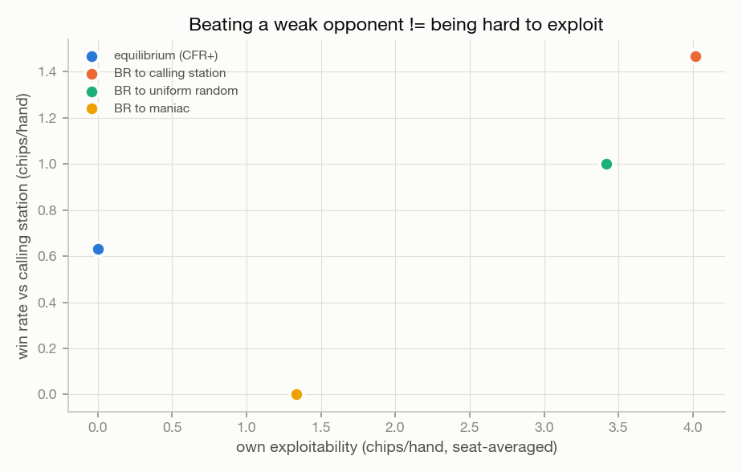

| strategy | own exploitability | vs calling station | vs uniform random | vs maniac |
|---|---|---|---|---|
| equilibrium (CFR+) | 3.4080e-05 | +0.633 | +0.707 | +0.335 |
| BR to calling station | 4.0167 | +1.467 | -0.890 | -1.333 |
| BR to uniform random | 3.4167 | +1.000 | +2.374 | -0.133 |
| BR to maniac | 1.3333 | +0.000 | +0.442 | +2.367 |

A best response to a weak opponent beats it by much more than the equilibrium does, while being orders of magnitude more exploitable. Winning against weak opponents says nothing about how close you are to equilibrium.
